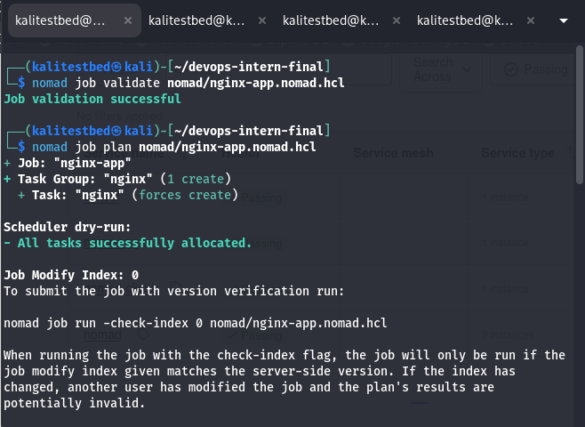
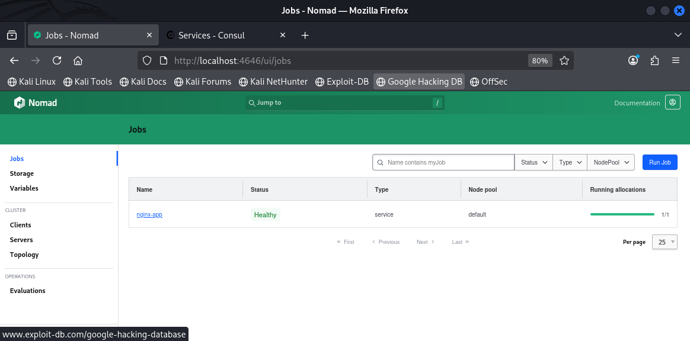
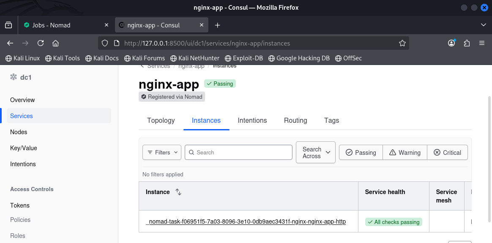
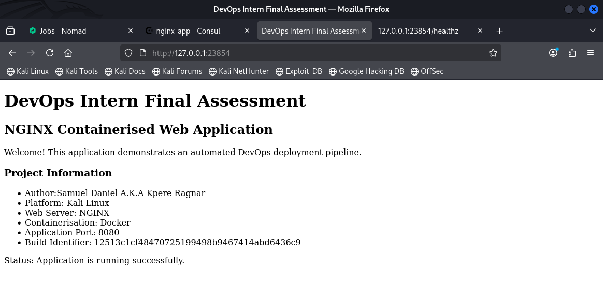
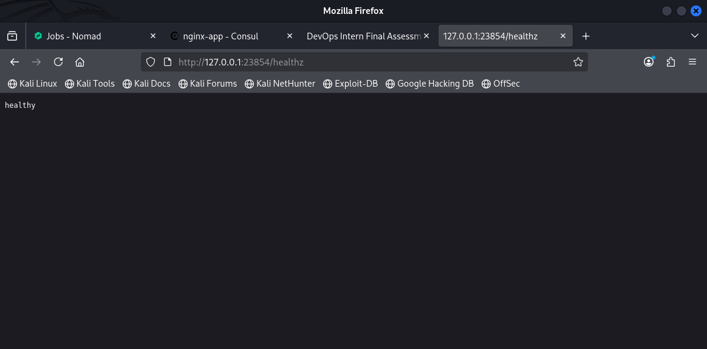
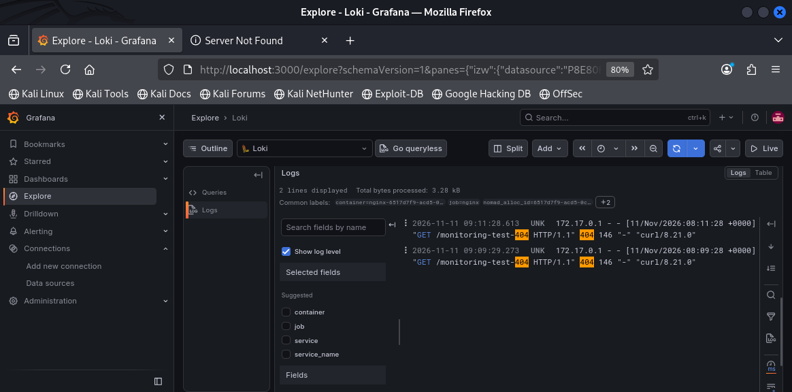

# DevOps Intern Final Assessment

An end-to-end DevOps implementation demonstrating the automation, containerisation, continuous integration, deployment, service discovery, centralised logging and monitoring of an NGINX web application.

**Author:** Kpere Ragnar
**Repository:** [devops-intern-final](https://github.com/kpereragnar/devops-intern-final)
**Container Registry:** `ghcr.io/kpereragnar/devops-intern-final`

---

## 1. Project Overview

This project implements an automated DevOps workflow covering the complete application delivery lifecycle:

- Source control and collaborative development using Git and GitHub.
- Lightweight, non-root NGINX containerisation using Docker.
- Linux automation and application health-check scripts.
- Automated linting, building and testing using GitHub Actions.
- Container image publishing to GitHub Container Registry (GHCR).
- Container orchestration using HashiCorp Nomad.
- Service registration and health monitoring using Consul.
- Centralised container log collection using Promtail and Grafana Loki.
- Log exploration and visualisation using Grafana.

The implementation is designed as a reproducible single-node laboratory environment.

## 2. Architecture

```text
                    DEVELOPER
                        |
                        v
                  GIT / GITHUB
                        |
                 Pull Requests
                        |
                        v
                 GITHUB ACTIONS
                 /            \
                v              v
           SHELLCHECK       HADOLINT
                \              /
                 \            /
                  v          v
                  DOCKER BUILD
                        |
                 BUILD & TEST
                        |
                        v
                GITHUB CONTAINER
                   REGISTRY
                        |
                        v
                HASHICORP NOMAD
                        |
                        v
                  NGINX APP
                        |
                CONSUL SERVICE
                 REGISTRATION
                        |
                        v
                DOCKER LOGS
                        |
                        v
                    PROMTAIL
                        |
                        v
                  GRAFANA LOKI
                        |
                        v
                    GRAFANA
```

### Application request flow

1. A developer pushes code or opens a pull request.
2. GitHub Actions runs ShellCheck, Hadolint and Docker build tests.
3. Successful pushes to `main` trigger image publishing to GHCR.
4. Nomad deploys the published NGINX container.
5. Consul registers the service and checks its HTTP health endpoint.
6. Promtail discovers Nomad-managed Docker containers and collects their logs.
7. Loki stores and indexes the collected logs.
8. Grafana provides an interface for querying and exploring application logs.

## 3. Technology Stack

| Technology | Purpose | Version / Configuration |
|---|---|---|
| Kali Linux | Development environment | Rolling |
| Git | Source control | 2.51 |
| Docker Engine | Container runtime | 27.5.1 |
| Docker Compose | Monitoring orchestration | 2.32.4 |
| NGINX | Web server | 1.30.6-alpine-slim |
| ShellCheck | Shell script linting | 0.11.0 |
| GitHub Actions | CI/CD automation | GitHub-hosted runners |
| GHCR | Container registry | GitHub Container Registry |
| Nomad | Workload orchestration | 2.1.1 |
| Consul | Service discovery | 2.1.0 |
| Loki | Log aggregation | 3.7.9 |
| Promtail | Log collection | 3.6.11 |
| Grafana | Log visualisation | 13.3.0 |

Versions represent the development environment and container versions used during implementation.

## 4. Repository Structure

```text
devops-intern-final/
├── .github/
│   └── workflows/
│       └── ci.yml
├── app/
│   ├── Dockerfile
│   ├── index.html
│   └── nginx.conf
├── docs/
│   └── screenshots/
├── monitoring/
│   ├── grafana/
│   ├── loki/
│   ├── promtail/
│   ├── docker-compose.yaml
│   └── loki_setup.md
├── nomad/
│   └── nginx-app.nomad.hcl
├── scripts/
│   ├── healthcheck.sh
│   └── sysinfo.sh
├── .gitignore
└── README.md
```

#
## 5. Prerequisites

The following tools are required for the complete implementation:

- Linux environment.
- Git.
- Docker Engine and Docker Compose plugin.
- curl.
- jq.
- ShellCheck.
- HashiCorp Nomad.
- HashiCorp Consul.

Hadolint is executed automatically by the GitHub Actions workflow. Local installation is optional.

Docker must be running, and the current user must have permission to access the Docker daemon.

The monitoring stack requires sufficient memory for Loki, Grafana and Promtail. The Compose configuration sets container memory limits.


## 6. Quick Start

The following commands build, launch and test the application locally.

Run them from the repository root.

> **Note:** This quick start covers local Docker deployment only. For Nomad deployment and centralised monitoring, follow Sections 10 and 11 respectively.

**1. Build the image**

```bash
docker build \
  --build-arg BUILD_SHA="$(git rev-parse HEAD)" \
  -t devops-intern-nginx:local \
  -f app/Dockerfile app/
```

**2. Start the application**

```bash
docker run -d \
  --name devops-nginx-local \
  -p 8080:8080 \
  devops-intern-nginx:local
```

**3. Execute the application health check**

```bash
./scripts/healthcheck.sh http://localhost:8080/healthz
```

Expected result:

```text
SUCCESS: Application is healthy.
HTTP Status: 200
```

**4. Test the application**

```bash
curl -i http://localhost:8080/
```

**5. Inspect container health**

```bash
docker inspect \
  --format '{{.State.Health.Status}}' \
  devops-nginx-local
```

Expected result:

```text
healthy
```

**6. Clean up**

```bash
docker rm -f devops-nginx-local
```

## 7. Docker Implementation

The application is packaged using a pinned NGINX Alpine Slim base image:

```dockerfile
FROM nginx:1.30.6-alpine-slim
```

### Container security and optimisation

The Docker implementation includes:

- A pinned NGINX base image rather than the mutable `latest` tag.
- Non-root execution using the `nginx` user.
- A custom NGINX configuration.
- HTTP service on port `8080`.
- Docker HEALTHCHECK instruction.
- Build identifier embedded into the application.
- Temporary directories configured for non-root operation.

The final image was approximately **12.7 MB**, comfortably below the 60 MB assessment limit.

### Application endpoints

| Endpoint | Expected response |
|---|---|
| `/` | HTTP 200 |
| `/healthz` | HTTP 200 |
| `/nonexistent-path` | HTTP 404 |

The `/healthz` endpoint returns:

```text
healthy
```

## 8. Linux Automation Scripts

Two Bash automation scripts are included.

### System information

```bash
./scripts/sysinfo.sh
```

Reports:

- Current username and effective UID.
- Hostname and kernel version.
- ISO-formatted system date.
- Disk utilisation.
- Memory utilisation.
- Docker daemon status.

### Application health check

```bash
./scripts/healthcheck.sh
```

The script defaults to:

```text
http://localhost:8080
```

A custom URL can also be supplied:

```bash
./scripts/healthcheck.sh http://localhost:8080/healthz
```

The script returns exit status `0` for HTTP 200 and `1` for connection failures or unsuccessful HTTP responses.

Both scripts use Bash with strict error handling.

## 9. Continuous Integration and Delivery

The workflow is implemented in:

```text
.github/workflows/ci.yml
```

### Pipeline triggers

The workflow runs on:

- Pushes to `main`.
- Pull requests targeting `main`.

### Pipeline stages

**Stage 1 — Lint and Validate**

- ShellCheck validates shell scripts.
- Hadolint checks Dockerfile best practices.

**Stage 2 — Build and Test**

- Builds the NGINX Docker image.
- Starts the application container.
- Waits for Docker health status.
- Executes the application health-check script.
- Tests the homepage.
- Verifies the embedded build SHA.
- Checks that the image remains below 60 MB.

**Stage 3 — Publish**

The publishing job runs only after successful linting and build tests on pushes to `main`.

Images are published to:

```text
ghcr.io/kpereragnar/devops-intern-final
```

Two tags are published:

```text
latest
<commit-sha>
```

Authentication uses the GitHub-provided `GITHUB_TOKEN` with package write permissions. No long-lived registry credentials are required.

## 10. Nomad and Consul Deployment

The Nomad job specification is located at:

```text
nomad/nginx-app.nomad.hcl
```

### Deployment configuration

| Setting | Value |
|---|---|
| Job type | Service |
| Task driver | Docker |
| Desired instances | 1 |
| Container port | 8080 |
| CPU allocation | 100 MHz |
| Memory allocation | 64 MB |
| Service provider | Consul |
| Health endpoint | `/healthz` |
| Health interval | 10 seconds |
| Health timeout | 2 seconds |
| Automatic rollback | Enabled |

The specification also includes restart, rescheduling and rolling-update policies.

### Start Consul

Open a terminal:

```bash
sudo consul agent -dev -client=127.0.0.1
```

### Start Nomad

Open another terminal:

```bash
sudo nomad agent -dev
```

Keep both agents running.

### Validate the job

```bash
nomad job validate nomad/nginx-app.nomad.hcl
```

### Preview the deployment

```bash
nomad job plan \
  -var="image_tag=latest" \
  nomad/nginx-app.nomad.hcl
```

### Deploy the application

```bash
nomad job run \
  -var="image_tag=latest" \
  nomad/nginx-app.nomad.hcl
```

### Inspect deployment status

```bash
nomad job status nginx-app
```

```bash
nomad alloc status <allocation-id>
```

Nomad assigns a dynamic host port to the application. Inspect the allocation's network information to identify the allocated port before accessing the application.

### Verify Consul health

```bash
curl -s \
  "http://127.0.0.1:8500/v1/health/service/nginx-app?pretty" \
  | jq
```

The service should report a passing HTTP health check.

Nomad UI:

```text
http://127.0.0.1:4646/ui/
```

Consul UI:

```text
http://127.0.0.1:8500/ui/
```

## 11. Centralised Logging and Monitoring

The monitoring stack is defined in:

```text
monitoring/docker-compose.yaml
```

It consists of:

- Loki for log aggregation and storage.
- Promtail for discovering and collecting container logs.
- Grafana for log exploration and visualisation.

Promtail discovers Docker containers through Docker service discovery and filters for Nomad allocation containers.

It collects Docker JSON logs and forwards them to Loki.

### Start the monitoring stack

From the repository root:

```bash
docker compose -f monitoring/docker-compose.yaml config -q
```

```bash
docker compose -f monitoring/docker-compose.yaml up -d
```

### Verify the services

```bash
docker compose -f monitoring/docker-compose.yaml ps
```

Check Loki readiness:

```bash
curl http://127.0.0.1:3100/ready
```

Check Grafana:

```bash
curl http://127.0.0.1:3000/api/health
```

### Grafana access

Open:

```text
http://127.0.0.1:3000
```

The default first-login credentials are `admin` / `admin`. Change the password when prompted.

The Loki datasource is provisioned automatically.

### LogQL queries

Open Grafana Explore and select Loki.

Retrieve all NGINX logs:

```logql
{job="nginx"}
```

Filter HTTP 404 responses:

```logql
{job="nginx"} |= "404"
```

Filter by service:

```logql
{service="nginx-app"}
```

Filter by Nomad allocation:

```logql
{nomad_alloc_id="YOUR_ALLOCATION_ID"}
```

The implementation was verified by generating HTTP 200 and HTTP 404 requests and confirming their appearance in Loki.

For additional configuration and troubleshooting instructions, see:

[Monitoring Setup Guide](monitoring/loki_setup.md).

## 12. Troubleshooting and Lessons Learned

The implementation involved several practical troubleshooting exercises.

### 1. Docker image exceeded the size requirement

**Problem:** The initial `nginx:1.30.6-alpine` image exceeded the 60 MB assessment limit.

**Resolution:** Replaced the base with the pinned `nginx:1.30.6-alpine-slim` image.

**Result:** Final image size reduced to approximately 12.7 MB.

### 2. Docker permission denied

**Problem:** Docker commands initially failed for the regular user despite Docker group membership being configured.

**Resolution:** Completed a full logout and login to refresh group membership.

**Result:** Docker commands worked without requiring `sudo`.

### 3. Nomad rescheduling validation failed

**Problem:** The Nomad job validation reported a conflict between a finite rescheduling attempt count and the default unlimited rescheduling setting.

**Resolution:** Explicitly configured:

```hcl
reschedule {
  attempts  = 3
  unlimited = false
}
```

**Result:** Nomad job validation succeeded.

### 4. Nomad development environment lost state

**Problem:** Stopping development agents removed their in-memory cluster state.

**Resolution:** Restarted Consul first, then Nomad, and redeployed the job.

**Lesson:** Development agents use ephemeral state and should not be treated as persistent production infrastructure.

## 13. Screenshots and Implementation Evidence

The following screenshots document the implementation and verification process.

### Nomad validation and deployment





### Consul service health



### NGINX application





### Grafana monitoring



## 14. Security Considerations and Known Limitations

This implementation is designed for a local assessment environment, not direct production deployment.

- Nomad and Consul run in development mode, with ephemeral state.
- Loki authentication is disabled; its HTTP endpoint is intended for isolated local use.
- Loki and Grafana ports are bound to localhost.
- Promtail mounts the Docker socket. Although the mount is marked read-only, this does not make Docker API access inherently read-only. Access to the socket carries significant host-level security implications.
- Promtail reached end of life on 2 March 2026. It is retained here to satisfy the assessment requirement; a future production implementation should migrate to Grafana Alloy.
- Loki uses single-node filesystem storage with a seven-day retention period.
- The Nomad job uses a single application instance and does not demonstrate multi-node high availability.

Production deployment would require additional controls, including authenticated service communication, persistent infrastructure, secure secret management, access controls, monitoring retention policies and high availability.

## 15. Project Status

**Implementation completed.**

The application build, CI/CD pipeline, GHCR publishing, Nomad deployment, Consul health checks, Loki log ingestion and Grafana datasource integration were successfully tested.

The repository includes implementation documentation and screenshots for assessment review.

## Author

**Kpere Ragnar**

DevOps | Cloud Engineering | Cybersecurity

GitHub: [@kpereragnar](https://github.com/kpereragnar)
